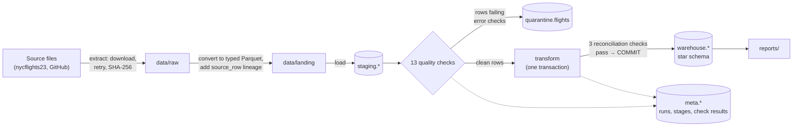

# NYC Flights Data Pipeline

An end-to-end batch data pipeline for all **435,352 flights** that left New York City's three airports (JFK, LaGuardia, Newark) in 2023. It extracts the raw source files, checks every row against 16 data-quality rules, quarantines bad records, and publishes a star-schema warehouse in DuckDB. The publish is atomic and only happens after the data reconciles. Every run is logged to metadata tables, so you can ask "what happened in the last run?" in SQL.

**Python · SQL · DuckDB · Parquet · pytest · GitHub Actions**

## Results at a glance

| | |
|---|---|
| Pipeline run (download → warehouse) | under 10 seconds for 467,668 source rows |
| Data-quality checks | 16 (7 quarantine rows, 6 warn, 3 reconcile the output) |
| Real source problems found | 1 flight with an impossible delay, 9,371 flights on aircraft missing from the registry, 73 hours of missing weather |
| Query benchmark (4.35M rows) | composite index: lookups **~1,000x** faster · column store: full-scan aggregates **48x** faster · Parquet vs. CSV: **11x** faster |
| Tests | 18 pytest tests, offline, ~5 s; checked by deliberately breaking the code |

Full outputs: [`reports/REPORT.md`](reports/REPORT.md) (data quality + analytics) and [`reports/BENCHMARK.md`](reports/BENCHMARK.md).

## How it works



| Stage | What it does | Code |
|---|---|---|
| Extract | Downloads each source file with retries, records its SHA-256 and size in a manifest, converts it to Parquet, and adds `source_row` so any row can be traced back to the source. | [`extract.py`](pipeline/extract.py) |
| Load | Rebuilds `staging.*` from Parquet on every run, so re-runs never double-load. Gives each flight a `flight_key` (a hash of its natural key). | [`load.py`](pipeline/load.py) |
| Quality | Runs every check as SQL. **Error** rows go to `quarantine.flights` with the name of the check they failed. **Warnings** keep the row and record the count. If more than 1% of rows fail, the run stops before the warehouse is touched. | [`quality.py`](pipeline/quality.py) |
| Transform | Builds the dimension, fact, and rollup tables inside one transaction, then reconciles: staged rows = warehouse rows + quarantined rows, total miles match, and the rollup adds up. It commits only if all three pass. | [`transform.py`](pipeline/transform.py), [`sql/transform/`](pipeline/sql/transform) |
| Telemetry | Logs each run, stage (duration, rows in/out), and check result to `meta.*`, and also as JSON lines. | [`telemetry.py`](pipeline/telemetry.py) |
| Report | Runs the analytics SQL and writes `reports/REPORT.md`. | [`report.py`](pipeline/report.py), [`sql/analytics/`](pipeline/sql/analytics) |

### Warehouse schema

| Table | Grain | Rows |
|---|---|---|
| `fact_flights` | one scheduled flight | 435,351 |
| `fact_weather_hourly` | one airport-hour | 26,207 |
| `agg_daily_carrier` | date × airline × origin (reporting rollup) | 10,079 |
| `dim_carrier`, `dim_airport`, `dim_aircraft`, `dim_date` | lookup tables | 14 / 1,255 / 4,840 / 365 |

The fact and dimension tables declare primary keys, so a duplicate can't sneak in even if a check is wrong.

## Quick start

```bash
pip install -r requirements.txt -r requirements-dev.txt
python -m pipeline                # download, check, and build data/flights.duckdb
python -m pipeline.report         # write reports/REPORT.md
python -m pipeline.benchmark      # write reports/BENCHMARK.md (about 2 minutes)
pytest -q                         # 18 tests, no network needed
```

Ask the run log what happened:

```sql
SELECT r.run_id, r.status, s.stage, s.duration_ms, s.rows_in, s.rows_out
FROM meta.pipeline_runs r JOIN meta.stage_metrics s USING (run_id)
ORDER BY r.started_at DESC, s.started_at;
```

## What the checks found in the real data

- **Daylight-saving time broke my first delay check, in both directions.** The check asserted *scheduled departure + delay = actual departure* using clock arithmetic. It flagged 2 flights, both overnight delays on the nights the clocks changed (March 12 and November 5), and both were actually correct: the delay is elapsed time, which differs from the clock difference by an hour across a DST switch. I rewrote the check to use time-zone-aware timestamps. That cleared both false alarms and caught a real error the naive check had missed: a JetBlue flight on the spring-forward night whose reported delay (529 minutes) is 60 minutes longer than the time that actually passed (469).
- **Doing it correctly made it 36x slower, so I narrowed where it runs.** Converting every row through the time zone database took 8.9 seconds. DST switches happen between midnight and 4 AM, so the exact method now runs only on the 2,436 flights whose delay window touches those hours, plus any row the fast check disagrees with. The quality stage went from 8.9 s back to 0.24 s with identical results, and a test pins all three real cases.
- **9,371 flights (277 aircraft) aren't in the aircraft registry.** They are kept and flagged with `aircraft_in_registry = false`, since the flight itself is valid.
- **The weather source is missing all of December 31** for every airport, plus one hour at LaGuardia on May 2. That leaves 826 flights with no weather reading. They are flagged with `has_weather = false` and left out of weather analysis.

## Query benchmark

The same three queries run against five storage setups on 4.35 million rows (the fact table copied 10x). Each result is verified identical across setups before timing.

| Query | SQLite (row store) | SQLite + index | DuckDB (column store) | DuckDB on CSV | DuckDB on Parquet |
|---|---|---|---|---|---|
| Lookup: one airline, one day | 246 ms | **0.24 ms** | 5.2 ms | 791 ms | 6.6 ms |
| Aggregate over every row | 2,815 ms | 2,768 ms | **58 ms** | 875 ms | 78 ms |
| Filter + aggregate | 379 ms | 61 ms | **12 ms** | 766 ms | 17 ms |

The takeaways: indexes win selective lookups but do nothing for full scans, column stores win analytics because they read only the columns a query needs, and the file format alone (CSV vs. Parquet) is an 11x difference on the same engine. Parquet also takes 182 MB vs. 423 MB for CSV. Details and query plans are in [`reports/BENCHMARK.md`](reports/BENCHMARK.md). Timings are from a 2-CPU Linux machine and will differ on yours.

## A few findings from the analytics

- **21.3%** of completed flights arrived 15+ minutes late.
- Delays build through the day. **8.9%** of 6 AM departures left 15+ minutes late, vs. **33.4%** at 8 PM.
- Heavy rain at the origin doubled the share of late departures (**41.6%** vs. **20.4%** in dry hours) and made cancellations **6x** more likely.
- July was the worst month: **35.8%** arrived late and **8.7%** were cancelled.

## Design decisions

- **Quarantine, don't drop or crash.** One bad row shouldn't block 435,000 good ones. Quarantined rows are kept with the check they failed, so they can be investigated and replayed. The 1% circuit breaker catches the opposite case, where the whole upstream file is broken.
- **Atomic publish.** Dashboards should never read a half-built warehouse. The transform and its reconciliation share one transaction, and a test forces a reconciliation failure to prove the old warehouse survives.
- **Idempotent runs.** Staging and the warehouse are rebuilt from the landed files, keys are deterministic hashes, and a test asserts two runs produce identical tables.
- **Lineage.** `source_row` follows every record from the source file through staging, quarantine, and the fact table.
- **Why DuckDB.** It's an in-process columnar SQL engine, so the whole warehouse is one file with no server to run. The SQL and the star-schema design carry over to cloud warehouses such as Azure Synapse or Fabric.

## What I'd do next

Run it on a schedule with an orchestrator, load incrementally by month instead of rebuilding, land the Parquet files in cloud storage (Azure Data Lake), and point it at a live feed. A good candidate is OCTA's real-time bus positions, which would make it a streaming telemetry pipeline.

## Data source

[nycflights23](https://github.com/moderndive/nycflights23) by ModernDive: on-time data for all flights that departed NYC in 2023, with airline, airport, aircraft, and hourly weather tables.
